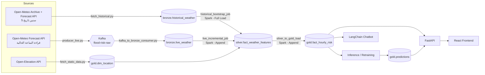
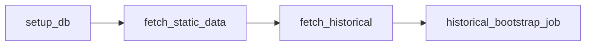
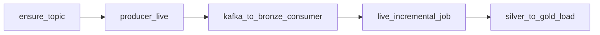

# 🏗️ Architecture
### Egypt Flash Flood Early Warning System

---

## 1) نظرة عامة

نظام لرصد وتوقع مخاطر السيول المفاجئة في **15 منطقة مصرية** معرضة للخطر، باستخدام بيانات طقس حية، ومعالجة Big Data (Spark)، ونموذج Machine Learning، وChatbot مبني على LangChain.

المشروع مبني على **Medallion Architecture** (Bronze ← Silver ← Gold) فوق SQL Server، وكل الـ orchestration بيتم عبر **Apache Airflow**.



---

## 2) الـ Tech Stack

| الطبقة | الأداة |
|---|---|
| مصدر البيانات | Open-Meteo (Archive + Forecast API) + Open-Elevation API |
| نقل البيانات اللايف | Apache Kafka 4.1 (محلي عبر Docker) |
| المعالجة | Apache Spark / PySpark 3.5 (`local[*]` جوه كونتينر Airflow) |
| الاتصال Spark ↔ SQL Server | JDBC عبر `mssql-jdbc` (`spark/jdbc_io.py`) |
| التخزين | SQL Server (محلي) |
| الـ Orchestration | Apache Airflow 2.10 (TaskFlow API، `LocalExecutor`) |
| التوقع | XGBoost |
| الذكاء التوليدي | LangChain + Chroma + Groq API |
| الـ Backend APIs | FastAPI |
| الـ Frontend | React |
| بيئة Python | 3.11، مُدارة عبر `uv` |
| Java | OpenJDK 17 (مطلوب لـ PySpark، متثبت في الـ Dockerfile) |

> **ملاحظة:** المعمارية مصممة لتكون Cloud-Portable — قابلة للنقل مستقبلًا لـ Azure (Event Hubs بدل Kafka، Azure SQL بدل SQL Server المحلي، Databricks بدل Spark المحلي) بدون تغيير في منطق الكود.

---

## 3) الطبقات (Medallion)

راجع `docs/data_contract.md` للحصول على تفاصيل كل جدول وعمود بالضبط.

| الطبقة | الجداول | الوصف |
|---|---|---|
| **Bronze** | `bronze.historical_weather`, `bronze.live_weather` | بيانات خام كما وصلت من المصدر (`event_time` نص)، بدون تنظيف |
| **Silver** | `silver.fact_weather_features` | بيانات منظفة + مُثراة (join مع `dim_location`) + كل الـ engineered features (rolling sums, lags) |
| **Gold** | `gold.dim_location`, `gold.fact_hourly_risk`, `gold.predictions` | جداول جاهزة للاستهلاك: درجة الخطورة والمستوى والتوقعات |

---

## 4) الـ Airflow DAGs

فيه DAGين بس، مكتوبين بـ TaskFlow API (`@dag` / `@task.bash`) في `orchestration/dags/`:

### 4.1 `historical_bootstrap` — مرة واحدة

| | |
|---|---|
| **الملف** | `dag_historical_bootstrap.py` |
| **الجدولة** | `@once` — بيشتغل مرة واحدة تلقائيًا أول ما Airflow يشوفه |
| **الترتيب** | `setup_db` ← `fetch_static_data` ← `fetch_historical` ← `historical_bootstrap_job` |



- `fetch_historical` بيسحب **آخر 5 سنين لحد الساعة الحالية** (UTC) — راجع القسم 5.
- `historical_bootstrap_job` (Spark) بيحوّل كل صفوف Bronze التاريخية لـ Silver بالكامل.
- لإعادة التشغيل يدويًا: `airflow dags trigger historical_bootstrap`، أو **Clear** على الـ run من الـ UI.

### 4.2 `hourly_ingestion` — كل ساعة

| | |
|---|---|
| **الملف** | `dag_hourly_ingestion.py` |
| **الجدولة** | `@hourly`، `max_active_runs=1`، `catchup=False` |
| **الترتيب** | `ensure_topic` ← `producer_live` ← `kafka_to_bronze_consumer` ← `live_incremental_job` ← `silver_to_gold_load` |



- `silver_to_gold_load` بيشتغل **بعد** `live_incremental_job` مباشرة عشان ياخد الصفوف الجديدة اللي اتحسبت في Silver.
- `max_active_runs=1` بيمنع تداخل تشغيلين Spark على نفس الجداول.
- ⚠️ **لازم `historical_bootstrap` يكون خلص الأول.** `silver_to_gold_load` بيحسب عتبات المستويات من الصفوف التاريخية؛ لو مفيش صفوف historical في Silver، كل من `live_incremental_job` و`silver_to_gold_load` بيفشل برسالة واضحة (عشان ما يتكتبش في Silver صفوف live بـ features ناقصة)، والـ DAG بيتصلح تلقائيًا في أول ساعة بعد ما الـ bootstrap يخلص.

---

## 5) سحب البيانات التاريخية (`fetch_historical.py`)

- **المدى:** آخر 5 سنين لحد الساعة الحالية (UTC)، بيتحسب وقت التشغيل (مش تواريخ ثابتة).
- **مصدرين:** الـ Archive API (ERA5) بيتأخر عن الوقت الحقيقي بكام يوم، فالسحب على مرحلتين:
  1. **Archive API:** من تاريخ البداية لحد `اليوم − 7 أيام`.
  2. **Forecast API** (`past_days`): الأيام الأخيرة، ومقصوصة عند الساعة الحالية.
- الصفوف بتتدمج بدون تكرار أو فجوات (متحقق منه باختبار).
- **قيد معروف:** آخر 7 أيام من مصدر مختلف شوية عن ERA5، فممكن فرق طفيف في المطر عند نقطة الدمج.
- الصفوف بتتسجل `source = 'historical'` (حتى آخر 7 أيام).

---

## 6) مسارات Spark

كل الـ jobs في `spark/` وبتتشغل بـ `python spark/<job>.py` من جوه Airflow، وبتستخدم نفس الـ helpers:

| الملف | الدور |
|---|---|
| `jdbc_io.py` | إنشاء الـ SparkSession + قراءة/كتابة SQL Server عبر JDBC |
| `shared_feature_logic.py` | منطق التنظيف والـ features **المشترك** بين المسارين |
| `historical_bootstrap_job.py` | Bronze (historical) → Silver (Full Load) |
| `live_incremental_job.py` | Bronze (live) → Silver (Append) |
| `silver_to_gold_load.py` | Silver → Gold (`fact_hourly_risk`) |

### 6.1 `shared_feature_logic.py`
- **`clean_bronze_weather`:** تحويل `event_time` لـ timestamp، فلترة الصفوف الغير صالحة (مطر سالب، رطوبة خارج 0–100، …)، ملء القيم الاختيارية بصفر، **قص `soil_moisture` الأقل من صفر إلى صفر** (ERA5 بيطلع أحيانًا قيم سالبة صغيرة زي `-0.015`)، وإزالة التكرار بالاحتفاظ بأحدث `ingested_at`.
- **`enrich_with_location`:** join مع `gold.dim_location` لإضافة `elevation` و`slope_degree`، و`assert_all_locations_mapped` بيفشل لو مدينة ملهاش بيانات تضاريس.
- **`add_time_features`:** 
  - `rain_sum_{1,3,6,24,72}h` بـ **range window** على الثواني (الساعات الناقصة ما بتدخلش قراءات أقدم في الـ window).
  - `rain_lag_1h` / `rain_lag_24h` بـ self-join على الـ timestamp بالظبط.
  - `hour_of_day` و`month` (UTC).

### 6.2 `historical_bootstrap_job.py` (Full Load)
1. قراءة Bronze التاريخي + `dim_location`.
2. تنظيف ← إثراء ← features.
3. كتابة النتيجة في جدول مؤقت `silver.fact_weather_features_stage` (Spark overwrite، مسموح فقط لجداول `*_stage`).
4. في transaction واحدة: التأكد إن الـ stage مش فاضي ← حذف صفوف `historical` من Silver ← إدخالها من الـ stage ← حذف الـ stage.
   - يعني لو الـ job فشل في النص، Silver القديم **ما بيتلمسش**.

### 6.3 `live_incremental_job.py` (Append)
> **ملاحظة مهمة:** الـ window functions بتحسب على الصفوف الموجودة في الـ DataFrame بس. لو اتشغلت `add_time_features` على الصف الجديد لوحده، `rain_sum_24h/72h` هتساوي مطر الساعة الحالية و`rain_lag_*` هتبقى NULL.

عشان كده:
1. قراءة صفوف `bronze.live_weather` اللي مش موجودة في Silver (anti-join على `city, event_time`).
2. تنظيف ← إثراء.
3. قراءة **آخر 71 ساعة** من Silver كـ context (الفلتر بيتنفذ جوه SQL Server).
4. `union` للـ context مع الصفوف الجديدة ← `add_time_features` ← **الاحتفاظ بالصفوف الجديدة فقط** (`left_semi` join).
5. `append` في Silver.

النتيجة متطابقة مع الحساب على التاريخ الكامل (متحقق منه باختبار على Spark: `rain_sum_72h` = 76 بدل 5، و`rain_lag_1h` = 1 بدل NULL).

### 6.4 `silver_to_gold_load.py`
1. قراءة Silver + التحقق من الأعمدة والقيم (قيم soil السالبة بتتقص لصفر قبل الفحص).
2. حساب `risk_score` (0–100) و`risk_level` — التفاصيل الكاملة في [`risk_scoring.md`](risk_scoring.md).
3. استبعاد الصفوف الموجودة بالفعل في Gold (anti-join) وكتابة الجديد فقط (`append`) — يعني إعادة التشغيل آمنة (idempotent).

---

## 7) الاتصال Spark ↔ SQL Server (`jdbc_io.py`)

| البند | التفاصيل |
|---|---|
| **المتغيرات المطلوبة** | `SQLSERVER_HOST`, `SQLSERVER_DATABASE`, `SQLSERVER_USER`, `SQLSERVER_PASSWORD` (اختياري: `SQLSERVER_PORT`) |
| **الدرايفر** | `com.microsoft.sqlserver:mssql-jdbc:13.6.0.jre11` — بيتنزل من Maven Central عند أول تشغيل |
| **الأمان** | الباسورد بييجي من الـ environment فقط، وأسماء الجداول بتتفحص بـ regex قبل أي استعلام |
| **Authentication** | SQL Authentication فقط (`SQLSERVER_TRUSTED_CONNECTION=yes` مش مدعوم جوه كونتينر Linux) |
| **الأداء** | `fetchsize=10000` للقراءة، `batchsize=1000` للكتابة، `spark.sql.shuffle.partitions=16`، `spark.ui.enabled=false` |
| **Timezone** | `spark.sql.session.timeZone=UTC` (مهم لـ `hour_of_day` وتحويل `event_time`) |
| **الكتابة** | `append` فقط على الجداول الحقيقية؛ الـ `overwrite` مقصور على الجداول المنتهية بـ `_stage` |
| **متغيرات اختيارية** | `SPARK_MASTER` (الافتراضي `local[*]`)، `SPARK_SHUFFLE_PARTITIONS`، `SPARK_IVY_DIR` (cache دائم لـ jar الدرايفر) |

> داخل Docker، `SQLSERVER_HOST` بيتحدد في `docker-compose.yml` على `host.docker.internal` عشان الكونتينر يوصل لـ SQL Server على الجهاز.

---

## 8) دورة الموديل

- **Inference** (كل ساعة): يقرأ صف واحد جاهز من `gold.fact_hourly_risk` (فيه كل الـ features already computed) → `predict()` → يكتب في `gold.predictions`.
- **Retraining** (أسبوعيًا): يتدرب على كل تاريخ `silver.fact_weather_features` → يقارن بالموديل الحالي (Champion vs Challenger) → يحتفظ بالأفضل فقط.

---

## 9) توزيع المسؤوليات

راجع `Team_Tasks_And_Warehouse_Reference.md` للتفاصيل الكاملة لكل شخص. ملخص سريع:

| الشخص | المسؤولية |
|---|---|
| محمد طارق | Ingestion (Static + Historical + Live) + LangChain + Orchestration |
| منه وخيري | Data Warehouse (Schema + Data Contract) |
| يوسف | Spark Jobs + React Frontend |
| عمرو | Analysis + APIs |
| عبد الرحمن | Machine Learning |

---

## 10) بيئة التشغيل المحلية

```
Docker Compose → Kafka + Airflow (+ Postgres metadata DB)
SQL Server → على الجهاز نفسه (بيتوصل له الكونتينر عبر host.docker.internal)
                        │
  كونتينر Airflow (Java 17 + Python 3.11 عبر uv) → PySpark, XGBoost, LangChain, FastAPI...
```

راجع `README.md` لخطوات التثبيت الكاملة.

---

*هذا المستند مرجع معماري عام. للتفاصيل الدقيقة (أسماء الأعمدة، الرسائل، الـ Endpoints) ارجع دائمًا لـ `data_contract.md`، ولطريقة حساب الخطورة لـ `risk_scoring.md`.*
