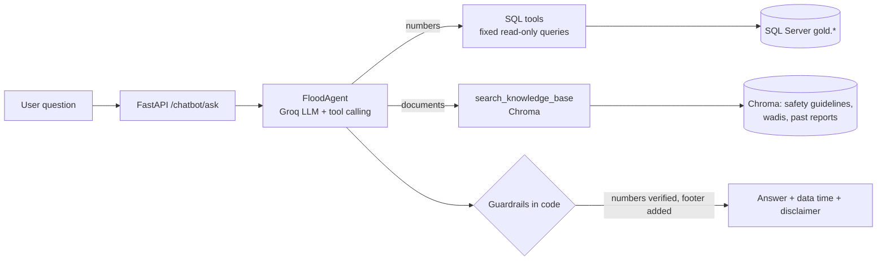

# 🤖 GenAI Agent
### Egypt Flash Flood Early Warning — Chatbot Agent + LLM-written Alerts

---

## 1) لماذا Agent وليس RAG فقط؟

بيانات الخطورة **أرقام في جداول** (`gold.fact_hourly_risk`, `gold.predictions`)، والـ RAG مصمم للمستندات النصية. لو حطينا صفوف الجداول في Chroma، الـ embeddings مش بتحفظ الأرقام بدقة وهتطلع إجابات رقمية غلط.

الحل: **Agent بيختار الأداة المناسبة لكل سؤال**:

| نوع السؤال | الأداة | المصدر |
|---|---|---|
| "إيه مستوى الخطورة في أسوان؟"، "أخطر 5 مناطق"، "توقعات الغردقة"، "أحداث خطر سابقة" | **SQL tools** | `gold.*` (أرقام حية) |
| "أعمل إيه لو السيل جه؟"، "وصف وادي كذا"، "تقرير سيل سابق" | **RAG (Chroma)** | مستندات حقيقية في `genai/knowledge/` |

LangChain وChroma وGroq كلهم باقيين، لكن كل واحد في دوره الصح.



---

## 2) الملفات

| الملف | الدور |
|---|---|
| `genai/settings.py` | الثوابت (المدن، المستويات، الحدود، الـ disclaimer) |
| `genai/db.py` | قراءة فقط من SQL Server (يرفض أي شيء غير `SELECT`) |
| `genai/tools.py` | الـ SQL tools (6 أدوات) |
| `genai/vector_store_setup.py` | فهرسة المستندات في Chroma |
| `genai/rag.py` | أداة البحث في المستندات |
| `genai/chatbot_chain.py` | الـ Agent + الـ guardrails |
| `genai/data_to_text.py` | تجهيز بيانات التنبيه + القالب الاحتياطي |
| `genai/alerts.py` | كتابة التنبيه بالـ LLM + التحقق منه |
| `genai/chatbot_api.py` | FastAPI |
| `genai/knowledge/` | المستندات (RAG) |
| `genai/smoke_check.py` | فحص صحة شامل على الـ warehouse الحقيقي (`python -m genai.smoke_check`) |
| `genai/eval_questions.py` | 20 سؤال على Groq الحقيقي مع فحوصات أوتوماتيكية (`python -m genai.eval_questions`) |
| `genai/eval_results/` | مكان حفظ نتائج الـ eval (JSON) + baseline للمقارنة |
| `genai/tests/` | 100 اختبار |

---

## 3) الـ SQL tools

الـ LLM **مش بيكتب SQL**. كل أداة بتنفذ استعلامات ثابتة (parameterized) ومقصورة على القراءة.

| الأداة | بترجع |
|---|---|
| `get_current_risk(city)` | آخر `risk_score` و`risk_level` والمطر التراكمي لمنطقة |
| `get_top_risky_regions(n)` | أعلى N مناطق خطورة (آخر قراءة لكل منطقة) |
| `get_risk_history(city, hours)` | آخر `hours` ساعة (حد أقصى 168) |
| `get_weather_outlook(city)` | توقعات النموذج من `gold.predictions` (ممكن تكون فاضية) |
| `get_past_events(city, min_level, days)` | أحداث خطورة سابقة: ساعات متتالية عند مستوى معين أو أعلى (فجوة ≤ 3 ساعات تتدمج) |
| `list_supported_regions()` | المناطق الـ 15 ومستويات الخطورة |

كل نتيجة فيها: `status` (`ok` / `no_data` / `error`)، و`data_as_of` (UTC)، و`stale` (لو البيانات أقدم من `GENAI_STALE_AFTER_HOURS`، الافتراضي 3 ساعات). أسماء المدن بتتفهم بالعربي والإنجليزي (`أسوان` = `Aswan`، `الغردقه` = `Hurghada`...).

---

## 4) الـ Guardrails (بتتنفذ في الكود)

| القاعدة | التنفيذ |
|---|---|
| **كل رقم من tool** | بعد كل إجابة، الكود بيطلّع كل الأرقام فيها ويقارنها بنتائج الـ tools. رقم مش موجود → رسالة تصحيح للموديل مرة واحدة، ولو استمر → إجابة احتياطية بدون الرقم ده |
| **سؤال بيانات بدون tool** | لو السؤال عن مدينة/خطورة/مطر والموديل جاوب من غير ما يستدعي tool → اتصحح مرة، وبعدها إجابة احتياطية |
| **عرض وقت البيانات** | سطر "آخر تحديث للبيانات: … UTC" بيتضاف بالكود (أقدم `data_as_of` في الأدوات المستخدمة) + تحذير لو `stale` |
| **"مفيش بيانات" بدل التخمين** | `no_data` / `error` بيوصل للموديل، والـ prompt بيلزمه يقول إن البيانات مش متاحة. مدينة غير معروفة → قائمة المدن الصحيحة |
| **"ليس تحذيرًا رسميًا"** | الـ disclaimer بيتضاف بالكود لكل إجابة (حتى الاحتياطية)، فمحاولات "تجاهل التعليمات" ما تقدرش تشيله |
| **المصادر** | عناوين المستندات المسترجعة بتتضاف تحت الإجابة |
| **حماية من الحقن** | نتائج الـ tools والمستندات بتتعامل كبيانات مش تعليمات |
| **حدود** | سؤال ≤ 1000 حرف، ≤ 6 خطوات للـ agent، history ≤ 6 رسائل، role مقبول: user/assistant |

> ⚠️ **حدود التحقق من الأرقام:** فحص heuristic. بيقبل تقريب (±0.5 للأعداد الصحيحة، ±0.05 للكسور)، وبيتأكد إن الرقم **موجود** في البيانات مش إنه **منسوب للكيان الصح** (مثلًا رقم مدينة منسوب لمدينة تانية). عشان كده الـ prompt بيمنع الحسابات الجديدة، والأدوات بترجع صفوف صغيرة وواضحة.

---

## 5) التنبيهات اللي بيكتبها الـ LLM

الحقائق من البيانات والـ LLM بيكتب الصياغة بس.

1. `build_alert_payload(city)` يجمع من SQL: المنطقة، المستوى الحالي، **وقت الذروة** (أعلى توقع من `gold.predictions` لو أعلى من الحالي، وإلا الساعة الحالية)، و**أهم العوامل** (المطر الحالي / 24 ساعة / 72 ساعة / الانحدار، مرتبة بنفس مراجع `docs/risk_scoring.md`).
2. الـ LLM بيكتب نص (عربي أو إنجليزي) من الـ JSON فقط.
3. **Validator**: يرفض النص لو فيه رقم أو منطقة أو مستوى مش في الـ payload، أو لو ما ذكرش المنطقة والمستوى الحالي. محاولتين.
4. لو فشل → **قالب ثابت** (`render_template_alert`) فيه نفس الحقائق. فالتنبيه دايمًا بيطلع، وكل معلومة فيه من البيانات.
5. الـ disclaimer بيتضاف بالكود. المناطق `Safe` ما بتعملش استدعاء للـ LLM.

الرد بيحتوي `source` (`llm` أو `template`) و`validation_problems` عشان تتابع جودة الـ LLM.

---

## 6) الـ API

| Endpoint | الوصف |
|---|---|
| `POST /chatbot/ask` | body: `{"question": "...", "history": [{"role":"user","content":"..."}]}` ← `{"answer": "...", "language", "tools_used", "data_as_of", "stale", "sources", "grounded", "status"}` |
| `GET /chatbot/alert/{city}?lang=ar\|en` | تنبيه جاهز للعرض (الـ Frontend ممكن يعرضه في `AlertBanner`) |
| `GET /chatbot/health` | فحص تشغيل |

العقد الأصلي (`POST /chatbot/ask` ← `{"answer": "..."}`) محفوظ؛ الحقول الإضافية غير كاسرة.

---

## 7) التشغيل

```powershell
# 1) متغيرات البيئة في .env
GROQ_API_KEY=...
GROQ_MODEL_NAME=llama-3.3-70b-versatile      # أي موديل في Groq بيدعم tool calling

# 2) فهرسة المستندات (بعد أي إضافة/تعديل في genai/knowledge)
uv run python -m genai.vector_store_setup

# 3) تشغيل الـ API
uv run uvicorn genai.chatbot_api:app --host 0.0.0.0 --port 8001

# 4) اختبارات (بدون SQL Server ولا مفتاح)
uv run pytest genai/tests -q

# 5) فحص على الـ warehouse الحقيقي (أضف --llm لاختبار Groq الحقيقي)
uv run python -m genai.smoke_check

# 6) تقييم بـ 20 سؤال (بيحفظ النتيجة في genai/eval_results/)
uv run python -m genai.eval_questions
```

متغيرات اختيارية: `CHROMA_DIR`, `RAG_MAX_DISTANCE` (الافتراضي 0.75، يتظبط على المستندات الحقيقية)، `RAG_TOP_K`, `GENAI_STALE_AFTER_HOURS`, `GENAI_MAX_AGENT_STEPS`, `GENAI_RATE_LIMIT_RETRIES` (الافتراضي 4), `GENAI_RATE_LIMIT_MAX_WAIT` (الافتراضي 30 ثانية), `CORS_ORIGINS`.

> أول تشغيل لـ Chroma بينزّل موديل الـ embedding الافتراضي (إنترنت مطلوب مرة واحدة).

---

## 8) المستندات (RAG)

الفولدر `genai/knowledge/`:
- `safety_guidelines/` — إرشادات عامة (عربي + إنجليزي) **تتراجع مع الحماية المدنية قبل الإنتاج**.
- `wadi_descriptions/` و`past_flood_reports/` — فاضيين (فيهم `_TEMPLATE.md`). **لازم الفريق يضيف مستندات حقيقية بمصدر**. بدون مصدر مفيش ملف؛ الـ agent هيقول "مفيش مستند" بدل ما يألف.

---

## 8.4) حدود Groq (خطأ 429) وعدد الـ tokens

Groq بيحدّد عدد الـ tokens في الدقيقة (TPM) حسب الموديل والخطة. مثال من تشغيل فعلي على `openai/gpt-oss-120b` في الخطة المجانية:
`Rate limit reached ... tokens per minute (TPM): Limit 8000, Used 5764, Requested 2276. Please try again in 300ms`.

كل سؤال بيعمل غالبًا **استدعاءين** للموديل (اختيار الأداة، ثم صياغة الإجابة)، وكل استدعاء بيبعت الـ prompt وتعريفات الأدوات السبعة ونتيجة الأداة (حوالي 2000–2500 token). يعني الميزانية بتكفي لسؤال أو اتنين في الدقيقة، وده طبيعي في الخطة المجانية.

**اللي الـ agent بيعمله (`FloodAgent._invoke`):**
- لو جاله 429: يستنى الوقت اللي Groq بيقوله في الرسالة (`try again in 300ms / 2.5s / 1m3.5s`) + نص ثانية، ويعيد الاستدعاء (حد أقصى `GENAI_RATE_LIMIT_RETRIES` مرات).
- لو Groq طلب انتظار أطول من `GENAI_RATE_LIMIT_MAX_WAIT` (مثلًا حد يومي: `try again in 7m12s`) ما بيستناش ولا بيعيد، لأن الانتظار جوه طلب واحد مش هيحلها.
- لو فشل بعد المحاولات: يرجّع رد واضح ("الخدمة مزدحمة حاليًا… حاول بعد دقيقة") بدل رسالة خطأ عامة، مع `checks_failed: ["llm: rate_limited"]` والتنبيه الرسمي. الـ API بيرجّعه بـ HTTP 200 و`status: "fallback"`.
- أي خطأ تاني من الموديل (انقطاع شبكة مثلًا) ما بيتعادش، ويتسجل في `checks_failed` كـ `llm: <نوع الخطأ>`.
- `tokens_used` في كل رد = مجموع tokens الاستدعاءات لهذا السؤال (0 لو المزوّد ما بعتش الرقم). نتائج الأدوات بقت JSON مضغوط لتقليل الاستهلاك.

**في الـ eval:** السؤال اللي اتعمله rate limit بيظهر بعلامة ⏳ مش ❌، وبيستنى 30 ثانية إضافية قبل السؤال اللي بعده، والملخص بيفصل بين "rate-limited" و"failed". الملف المحفوظ فيه `rate_limited_questions` و`logic_failures` و`tokens_total`. أعد الأسئلة المتأثرة بـ: `--only <أرقام> --sleep 10`.

**لو الحد بيعطّلك:** (1) زوّد `--sleep` في الـ eval، (2) شوف حدود موديلات حسابك في `console.groq.com/settings/limits` واختار موديل بيدعم tool calling وحده أعلى، (3) ترقية الحساب. الأرقام دي بتتغير بتغيّر خطط Groq، فراجعها من حسابك مش من هنا.

---

## 8.5) تقييم الـ agent على Groq الحقيقي (`eval_questions`)

```powershell
uv run python -m genai.eval_questions                   # الـ 20 سؤال كلهم
uv run python -m genai.eval_questions --only 19 20      # أسئلة محددة
uv run python -m genai.eval_questions --sleep 5         # لو Groq رجّع rate limit
uv run python -m genai.eval_questions --verbose         # طباعة كل إجابة
uv run python -m genai.eval_questions --no-save         # من غير حفظ
```

**الفحوصات الأوتوماتيكية:** الأداة الصح اتستدعت، `status: ok`، `grounded: true`، التنبيه الرسمي موجود، لغة الإجابة = لغة السؤال، وقت البيانات ظاهر في أسئلة البيانات، ولا يوجد نص ممنوع (مثل رقم محقون في سؤال حقن، أو إجابة من الذاكرة لسؤال خارج النطاق). عمود **👁 review** بيقولك إيه لازم تقراه بنفسك لأن السكريبت ما يحكمش على الصياغة.

**مكان النتائج:** كل تشغيل بيتحفظ لوحده داخل `genai/eval_results/` (مش في جذر المشروع):

| الملف | الوصف | في git؟ |
|---|---|---|
| `eval_<UTC>.json` | تشغيل كامل | لا (متجاهَل) |
| `eval_<UTC>_partial.json` | تشغيل بـ `--only` | لا |
| `latest.json` | نسخة من آخر تشغيل **كامل** (التشغيل الجزئي ما بيمسحهوش) | لا |
| `baseline_*.json` | تشغيل محفوظ عمدًا للمقارنة | **نعم** |

- `--out اسم.json` بيحفظ داخل نفس الفولدر لو الاسم من غير مسار. لو فيه مسار بيتحترم.
- لحفظ تشغيل كدليل (مثلًا للمسابقة): `git add -f genai/eval_results/<الملف>.json`.
- الصيغة: `{run_at_utc, model, partial, total, passed, failed_questions, results: [...]}`. الملف الأقدم `baseline_2026-10-31_before_scope_fix.json` قائمة بسيطة بدون الـ metadata، و`load_results()` بيقرأ الصيغتين.
- التفاصيل في `genai/eval_results/README.md`.

---

## 9) اللي اتجرب واللي لسه

| | الحالة |
|---|---|
| منطق الأدوات والـ agent والتنبيهات والـ API | ✅ 100 اختبار (SQLite + LLM تمثيلي + embedding بسيط) |
| ربط الأدوات بـ `ChatGroq` الحقيقي (schemas) | ✅ |
| استدعاء Groq الحقيقي (جودة اختيار الأدوات بالعربي) | ⬜ يحتاج `GROQ_API_KEY` — جرّب أسئلة حقيقية وراقب `tools_used` و`grounded` |
| Chroma بموديل embedding الحقيقي وضبط `RAG_MAX_DISTANCE` | ⬜ |
| تشغيل ضد SQL Server الحقيقي | ⬜ (الاستعلامات ANSI-compatible بس ما اتشغلتش على SQL Server) |
| `gold.predictions` | فاضي لحد ما يشتغل `ml/inference_job.py` → `get_weather_outlook` هيرجع `no_data` وده سلوك صحيح |
